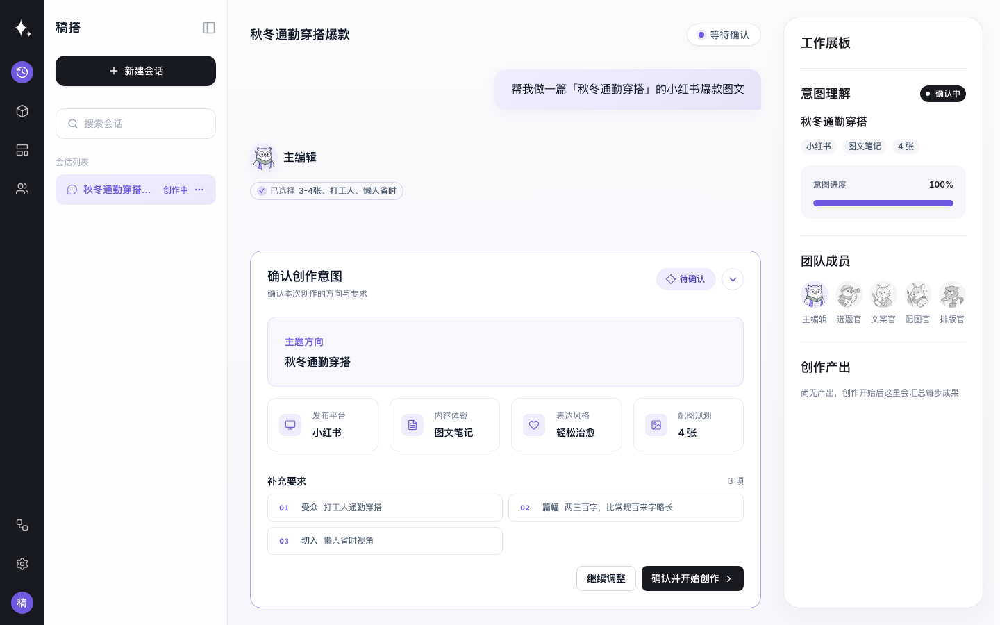
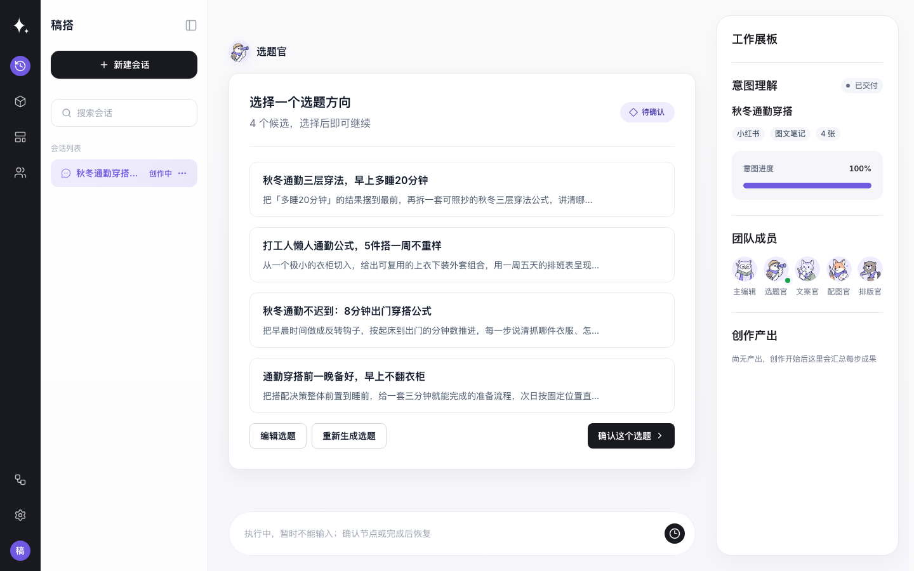
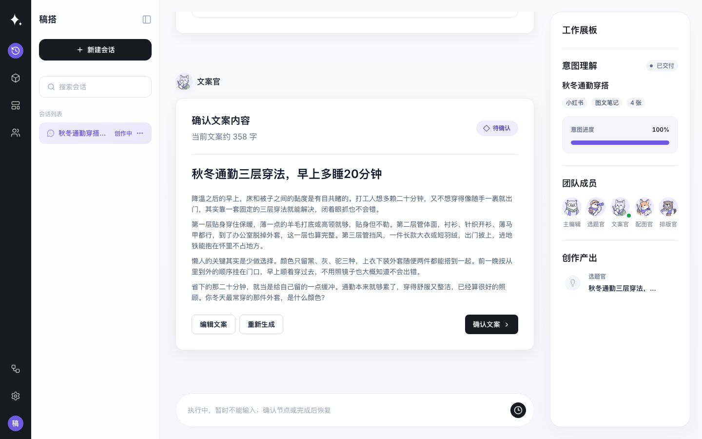
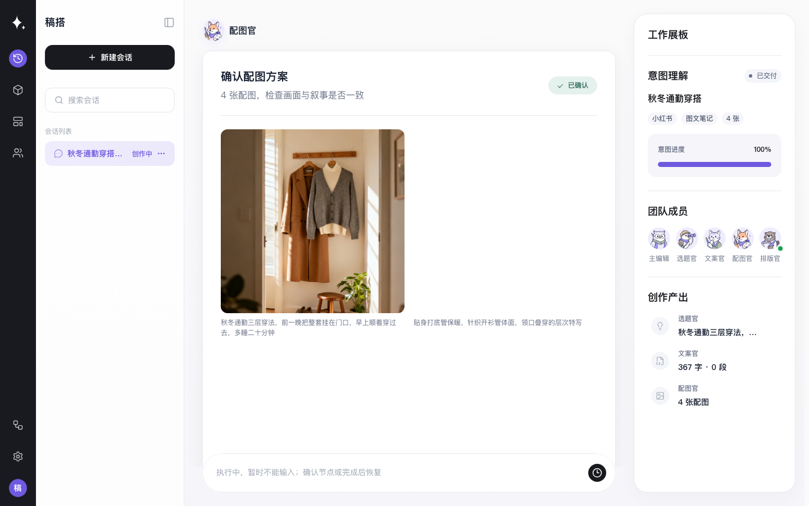
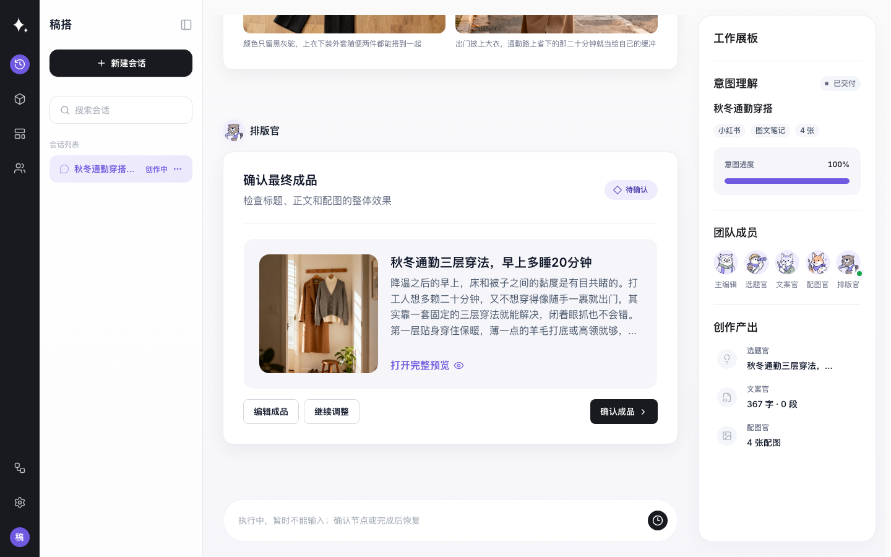
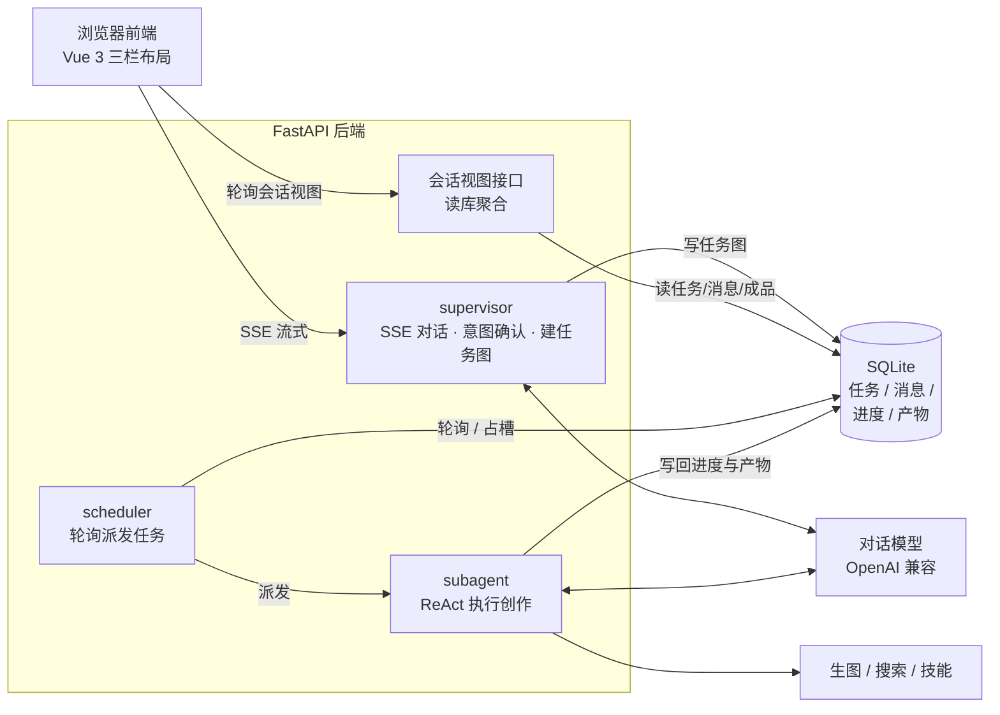

# Chorus

**Chorus 是一个多 Agent 图文博文创作助手**：输入一个主题，经过意图确认、选题、文案、配图与人工审阅，产出一篇可直接使用的图文成品（PostCard）——每一阶段的产出都由你确认或修改后才继续。

后端 FastAPI + SQLite，前端 Vue 3，对话与生图模型均可配置（OpenAI 兼容接口 + 火山方舟生图）。

## 效果展示

以下素材来自同一次真实运行。

输入主题原句：

> 帮我做一篇「秋冬通勤穿搭」的小红书爆款图文

### 意图确认



助手将主题、发布平台、内容体裁、表达风格、配图数量和补充要求整理成确认卡片，等待人工确认后再开始创作。

### 选题确认



选题官围绕“秋冬通勤穿搭”给出 4 个候选方向，用户可以编辑、重新生成或确认其中一个，确认后才会继续派发文案任务。

### 文案确认



文案官根据已确认的选题生成标题与正文，用户可以编辑、重新生成或确认当前文案，确认后才会继续派发配图任务。

### 配图确认



配图官生成 4 张真实配图后暂停等待确认。确认卡保留原图内容比例，但前端预览使用正方形容器，并根据可用宽度动态排成两列两行。

本次真实运行记录：

- 输入主题原句：`帮我做一篇「秋冬通勤穿搭」的小红书爆款图文`
- 对话模型：DeepSeek V4 Flash（`deepseek-v4-flash`）
- 生图模型：Seedream 4 / 火山方舟（`doubao-seedream-4-0-250828`）
- 成品人工修改：成品正文与配图未人工修改；本次仅调整了前端预览的显示方式。

### 最终成品确认



排版官将标题、正文和配图汇总为待确认成品；本次运行中封面在确认卡内以正方形预览，点击“打开完整预览”可继续查看完整 PostCard。

### 最终 PostCard 成品预览


完整预览中，原始 3:4 配图在左侧画布内铺满显示，超出画布的部分裁切隐藏；右侧展示标题、正文和互动区域。

## 创作流程


每一步由谁做、你能控制什么：

| 步骤 | Agent 做什么 | 你能确认 / 修改什么 | 产出 |
| --- | --- | --- | --- |
| 意图确认 | 归纳主题、平台与风格，明确创作方向 | 补充约束、要求澄清，确认后才建任务图 | 确认后的创作方向与任务图 |
| 选题 | 产出候选选题方案 | 在确认卡片中选定 / 要求重跑 / 放弃 | 选定的选题 |
| 文案 | 结合选题写标题与正文 | 确认文案；不满意可重跑或对话修改 | 标题与正文稿件 |
| 配图 | 按文案生成插图 | 确认配图；可要求重新生成 | 插图 |
| 排版合成 | 图文组装为 PostCard 成品 | 确认成品；确认后可在对话中继续修改 | PostCard 成品 |
| 成品确认与记忆 | — | 确认成品后记录创作偏好；纠错反馈也会沉淀为创作者记忆，影响后续创作 | 已确认的成品与更新的记忆 |

人工确认贯穿全程：每个阶段产出先挂起等待确认，确认后下游任务才会被派发执行；也可以中途放弃整个流水线。

## 快速启动

前置条件：[uv](https://docs.astral.sh/uv/)（Python 依赖管理）、Node.js（含 npm）。

1. 克隆并配置密钥：

   ```bash
   git clone https://github.com/MMyosotis/chorus.git && cd chorus
   cp .env.example .env
   ```

   在 `.env` 中填入：

   ```bash
   DEEPSEEK_API_KEY=sk-...      # 对话模型（必需）
   ARK_API_KEY=...              # 生图模型（完整跑通配图必需；暂无密钥可先在设置面板开启生图测试模式）
   BAIDU_SEARCH_API_KEY=...     # 联网搜索（可选）
   ```

2. 启动（首次运行会自动安装前后端依赖）：

   ```bash
   ./scripts/start.sh
   ```

   打开 **http://localhost:5173**，新建一个会话即可开始。

3. 试一个示例主题：`帮我写一篇秋日城市漫步主题的小红书图文笔记`。

   预期：先看到意图确认卡片 → 确认后任务图开始运行 → 右侧角色栏展示各 agent 状态 → 每阶段产出弹出确认卡片 → 最终得到 PostCard 成品。

> 模型与生图调用为外部付费服务，可能产生费用；生图可在设置面板开启测试模式（不产生真实调用）。
>
> 手动分别启动：后端 `uv sync && .venv/bin/uvicorn chorus.app:app --reload --port 8000`，前端 `cd web && npm install && npm run dev`。

## 系统架构



核心设计是**三条相互独立的执行循环，以数据库为通信媒介**：supervisor 与你对话并建任务图；scheduler 轮询任务表派发；子 agent 在后台线程执行创作并把进度、产物写回数据库；前端对 supervisor 走 SSE 流式，后台任务的数据经 FastAPI 会话视图接口聚合后由前端轮询渲染卡片。任务状态翻转（待执行 → 运行中 → 待确认 → …）是全部协调的核心，人工确认是状态机上的显式环节。

详细的数据流、任务状态机与分层依赖见 [docs/architecture.md](docs/architecture.md)。

## 配置与开发

**配置**：对话模型 / 生图模型 / 联网搜索 / 日志的完整配置说明见 [docs/configuration.md](docs/configuration.md)。模型表在 `chorus/config.py`，密钥值写在 `.env`。

**主要目录**：

```
chorus/        后端（config / app / domain / agents / services / repo / tools / routes）
web/           前端（Vue 3 + Vite 三栏布局）
scripts/       启动与数据库重建脚本
docs/          配置与架构文档
```

**常用命令**：

```bash
./scripts/start.sh                          # 同时启动前后端（开发模式）
.venv/bin/python -m chorus.tests            # 后端自动化测试
cd web && npm run test                      # 前端单测
cd web && npm run build                     # 前端构建
.venv/bin/python scripts/reset_db.py        # 重建产品库（清空数据，慎用）
```

## 项目状态

- **已实现**：多 Agent 流水线（选题 / 文案 / 配图 / 排版）、全流程人工确认与重跑、意图确认门禁、任务图运行进度与 trace 控制台、创作者记忆（跨会话沉淀偏好）、成品 PostCard 与对话式修改。
- **可选外部服务**：生图依赖火山方舟（可换厂商，需写接入代码）；联网搜索依赖百度千帆（需在设置面板开启联网搜索开关并配置密钥）；对话模型任意 OpenAI 兼容接口。
- **已知限制**：单机单库部署，SQLite 无并发会话锁（同一会话的并发发送靠前端规避）；效果受所选模型能力影响，产出质量不保证每次一致。
- **许可证**：仓库暂未附带开源许可证，复用前请先与作者联系。

反馈与问题请提 GitHub Issue。
